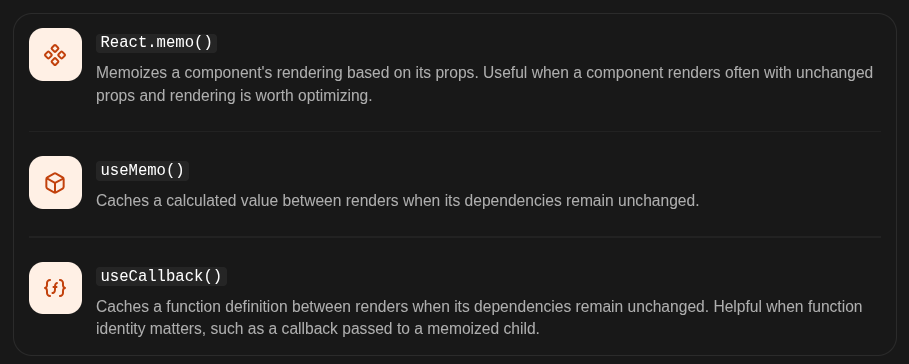

# React context api performance and Memoization 

## Use React.memo()
React.memo() lets React skip a component render when its props are unchanged, subject to React's normal rendering behavior.

```js
import { memo, useState } from "react"

const Profile = memo(function Profile(props) {
  console.log("profile component rendered....")
  return <h3>Hello, {props.name}</h3>
})
```

> Remember, memo is a performance optimization, not a guarantee. A memoized component can still render when its own state or a Context it consumes changes.

## Understand the three tools 



## Reference 
- [React Memo vs useMemo](https://dev.to/kells/react-memo-vs-usememo-3j52)
- [Official Docs - UseMemo](https://react.dev/reference/react/useMemo#examples-rerendering)
- [Official Docs - Memo](https://react.dev/reference/react/memo#skipping-re-rendering-when-props-are-unchanged)