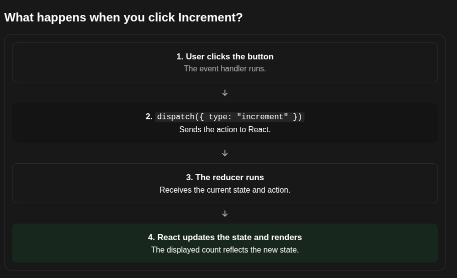

# Introducing React's useReducer Hook
React provides useReducer to manage state through a reducer function.

it's basic syntax: 
```js
const [state, dispatch] = useReducer(reducer, initialState);
```

Let's understand each part.
- state: the current state value managed by react. 
- dispatch: A function you call to tell React that an action occurred. 
- reducer: Your function that calculate the next state from the current state and an action. 
- initialState: the starting state value, used when the component initializes. 


### Example
```js 
import { useReducer } from "react";

function reducer(state, action) {
  if (action.type === "increment") {
    return state + 1;
  }

  return state;
}

function Counter() {
  const [count, dispatch] = useReducer(reducer, 0);

  return (
    <div>
      <p>Count: {count}</p>

      <button
        onClick={() => dispatch({ type: "increment" })}
      >
        Increment
      </button>
    </div>
  );
}

export default Counter;

```


